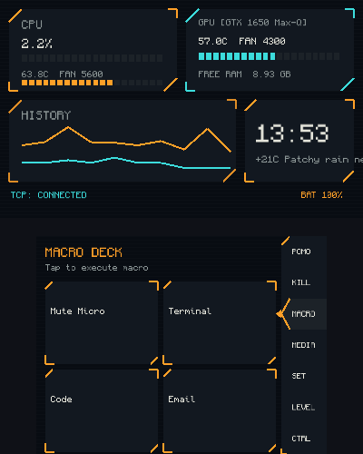
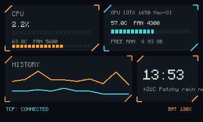
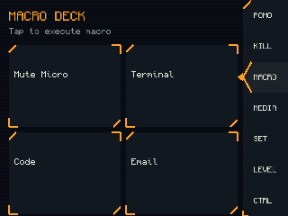
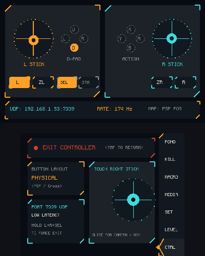

# SysMon

[](https://db.universal-team.net/3ds/sysmon)
[](LICENSE)
[](https://github.com/devkitPro/libctru)
[](https://www.rust-lang.org/)

SysMon turns your Nintendo 3DS into a secondary PC telemetry monitor, wireless macro pad, and virtual gamepad controller. Built in Rust and C.

The project connects your PC (Linux or Windows) and Nintendo 3DS over Wi-Fi, displaying real-time hardware metrics on the top screen while providing interactive tools and touch controls on the bottom screen.

<p align="center">
  
</p>

---

## Installation via Universal-Updater (3DS)

SysMon is officially indexed in **[Universal-DB](https://db.universal-team.net/3ds/sysmon)**!

1. Open **[Universal-Updater](https://universal-team.net/projects/universal-updater)** on your Nintendo 3DS.
2. Search for **`SysMon`**.
3. Select and install the `.cia` (installed directly to HOME Menu) or `.3dsx` (for Homebrew Launcher).

*Alternatively, download pre-built binaries from GitHub Releases or compile from source.*

---

## How It Works

SysMon consists of three core components:
- **`sysmon-server`**: A lightweight Rust daemon that lives in your Linux or Windows system tray. It gathers hardware statistics (CPU, GPU, RAM, sensors), dispatches macro commands, manages the virtual gamepad (via Linux kernel `/dev/uinput` or Windows ViGEmBus), and communicates with the 3DS.
- **`sysmon-web`**: An embedded web dashboard served by the background daemon for configuring ports, PINs, RAM sorting, and macros locally, or viewing live telemetry on mobile devices.
- **`sysmon-3ds`**: A native Nintendo 3DS homebrew application written in C using `citro2d` / `citro3d` with sound effects and custom theme support.

---

## Features

### Top Screen: Live Telemetry HUD

<p align="center">
  
</p>

The top screen presents an overview of host PC hardware status organized into four HUD panels and a status footer:

| Panel | Metric Displayed | Visual Bar / Gauge | Details & Behavior |
|---|---|---|---|
| **Top-Left (CPU)** | CPU Utilization (`%`) | **20-segment amber bar** | Real-time processor load across all CPU cores (`0%` to `100%`). |
| **Top-Left (CPU)** | CPU Temp (`°C`) & Fan (`RPM`) | **20-segment thermal bar** | Core package temperature and active fan speed. Color transitions: **Cyan/Normal** (<60°C), **Amber** (60–80°C), **Danger Red** (>80°C). |
| **Top-Right (GPU)** | GPU Model Name | Header text | Detects active dedicated GPU (NVIDIA, AMD Radeon, or Intel Arc). |
| **Top-Right (GPU)** | GPU Temp (`°C`) & Fan (`RPM`) | **20-segment thermal bar** | Core temperature and fan speed. **Note:** SysMon monitors GPU temperature and fan speed; this gauge represents temperature, not GPU load percentage. |
| **Top-Right (RAM)** | Available Memory (`FREE RAM`) | Numeric readout (`GB`) | Real-time free physical RAM available on host. |
| **Bottom-Left** | Thermal History Graph | **2-line real-time chart** | Displays temperature trends over the last 10 polling intervals. **Amber line** = CPU temperature; **Cyan line** = GPU temperature. |
| **Bottom-Right** | Digital Clock & Weather | Digital clock + text | Synchronized local time (`HH:MM`) and live weather condition/temperature fetched from wttr.in. |
| **Footer (Left)** | Connection State | Status text indicator | `TCP: CONNECTED` (Cyan), `TCP: CONNECTING` (Amber), or `TCP: ERROR` (Red). Press `SELECT` to toggle low-power pause or trigger reconnect. |
| **Footer (Right)** | 3DS Battery & Power | Battery percentage text | 3DS battery gauge (`BAT 20%`–`BAT 100%`) or active charging status (`CHG`). |

---

### Bottom Screen: Interactive Touch Tabs

<p align="center">
  
  &nbsp;&nbsp;&nbsp;&nbsp;
  
</p>

1. **`POMO` (Pomodoro Timer)**: Built-in focus timer with audible alert chime (`A` to toggle start/pause, `Y` to reset).
2. **`LEVEL` (Audio & Brightness Sliders)**: Real-time PC master volume and visual audio meter, plus display brightness controls.
3. **`KILL` (Process Manager)**: Live process list showing the heaviest CPU/RAM consumers. Tap any process and confirm with `A` to terminate it (`SIGKILL`).
4. **`MACRO` (Macro Pad)**: Touch macro pad (`T1`–`T8`) to trigger shell commands, key combos, URLs, or text inputs defined in Web Config.
5. **`MEDIA` (Media Controls)**: Native MPRIS (Linux) and window-title media player integration (Spotify, YouTube, VLC) with Play/Pause, Next, Previous, and volume adjustments.
6. **`CTRL` (Virtual Gamepad)**: Turns your 3DS into a low-latency PC game controller via Linux `/dev/uinput` or Windows ViGEmBus (Circle Pad, D-Pad, ABXY, L/R, ZL/ZR). Emergency exit: hold top-right touch corner for 1.5s to release grab.
7. **`SET` (Settings & Profiles)**:
   - **Themes**: Switch between built-in color schemes (Cyberpunk Amber, Matrix Green, Midnight Blue, Solarized, Monochrome) or create/edit custom palettes with live swatch previews.
   - **Servers**: Multi-server profile manager to configure and switch between multiple host PCs directly on the 3DS.
8. **`CAM` (Screen Streaming - *Optional / Experimental*)**: Mirrors your PC monitor to the 3DS top screen using PipeWire / Wayland portal or X11 capture with delta compression.
   > **Note:** Created purely as an experiment; tested on an Old 3DS with awful results due to hardware/Wi-Fi bottlenecks. Not recommended.

---

## Network & Firewall Configuration

SysMon uses the following ports:

| Port | Protocol | Purpose | Default / Optional |
|---|---|---|---|
| **`7341`** | TCP | 3DS Telemetry & Remote Commands | **Required** |
| **`7342`** | TCP / HTTP | Web Config (`/config`) & Mobile Telemetry (`/`) | **Required** |
| **`7339`** | UDP | Virtual Gamepad Controller Input | **Required for `CTRL` Tab** |
| **`7340`** | TCP / UDP | Screen Streaming Video Feed | *Optional (CAM build only)* |

### Open Ports in Firewall

**firewalld (Fedora / RHEL / openSUSE):**
```bash
sudo firewall-cmd --add-port=7341/tcp --add-port=7342/tcp --add-port=7339/udp --permanent
sudo firewall-cmd --reload
```

**UFW (Ubuntu / Debian / Arch):**
```bash
sudo ufw allow 7341/tcp comment 'SysMon Telemetry'
sudo ufw allow 7342/tcp comment 'SysMon Web'
sudo ufw allow 7339/udp comment 'SysMon Gamepad'
```

---

## Build & Installation

### 1. Linux Host Server (`sysmon-server`)

The server is built with Rust (Cargo). The **Standard Build (Default)** is lightweight (No-Cam) with minimal dependencies.

#### Option A: Native RPM Package (Fedora / RHEL / openSUSE)
```bash
cd sysmon-server
cargo build --release
cargo generate-rpm
sudo rpm -i target/generate-rpm/sysmon-server-*.rpm
```

#### Option B: Arch Linux / CachyOS / Manjaro
Run the universal installer script:
```bash
./install-arch.sh
```
Or build the native package using `makepkg`:
```bash
cd sysmon-server/packaging
makepkg -si
```

#### Option C: Run Directly via Cargo
```bash
cd sysmon-server
cargo run --release
```

#### Optional: Building with Screen Streaming (CAM Feature)
If you wish to compile the experimental screen streamer on PC:
```bash
cd sysmon-server
cargo build --release --features cam
cargo generate-rpm --variant cam
sudo rpm -i target/generate-rpm/sysmon-server-cam-*.rpm
```

---

### 2. Virtual Gamepad Setup (`/dev/uinput`)

To use the 3DS as a PC controller without running the server as `root`, grant non-root permissions to `/dev/uinput` using the included udev rule:

```bash
sudo cp sysmon-server/packaging/99-sysmon-uinput.rules /etc/udev/rules.d/
sudo udevadm control --reload-rules && sudo udevadm trigger
sudo usermod -aG input $USER
```
*(Note: Installing via RPM packages sets up these permissions automatically).*

---

### 3. Nintendo 3DS Client (`sysmon-3ds`)

Requires `devkitARM` and `libctru` installed in your environment (e.g. `/opt/devkitpro`).

#### Standard Build (Default - Lightweight / No-Cam):
```bash
cd sysmon-3ds

# Build .cia for FBI installation:
make cia

# Build .3dsx for Homebrew Launcher:
make
```

#### Optional Experimental Build (with CAM tab):
```bash
# Build Screen-Streaming .cia:
make cia-cam

# Build Screen-Streaming .3dsx:
make cam
```

---

## Configuration & Web Dashboard

`sysmon-server` sits headlessly in your Linux system tray.

To configure server settings:
1. Click the SysMon tray icon and choose **"Open Web Config"**.
2. Or navigate in your browser to `http://127.0.0.1:7342/config` (accessible only from `localhost` for security).
3. Set your **Auth PIN**, adjust ports, toggle RAM process sorting, and manage custom macros.

> **Mobile Telemetry Dashboard:** Open `http://<YOUR_PC_IP>:7342/` on your phone, tablet, or secondary device connected to the same Wi-Fi network for a read-only browser HUD.

### Configuring Macros
Macros can be created from the Web Config dashboard. Supported actions:
- `cmd`: Executes a shell script or terminal command (e.g. `wpctl set-mute @DEFAULT_AUDIO_SOURCE@ toggle`).
- `keys`: Native keyboard shortcut simulation via enigo *(Note: On Wayland compositors, global shortcuts may be restricted; use `cmd` with `ydotool` or desktop shortcuts if needed).*
- `open`: Instantly opens URLs or local file paths in default desktop apps.
- `text`: Types out a predefined string of text and presses Enter.

---

## Using the 3DS Client

1. **First Launch Connection**:
   - The app will prompt for your PC's IP address, Port (`7341`), and Auth PIN.
   - Credentials are saved to `sdmc:/sysmon_profiles.cfg` (backwards-compatible with `sdmc:/sysmon_cfg.txt`).
2. **Global Hotkeys**:
   - **`START`**: Cleanly disconnect and exit to 3DS HOME Menu / Homebrew Launcher.
   - **`SELECT`**: Toggle Sleep / Low Power Mode (pauses telemetry stream to conserve 3DS battery and network bandwidth).
3. **Gamepad Emergency Exit**:
   - When using the `CTRL` (Gamepad) tab, hardware button inputs are captured and transmitted to the PC. To release gamepad lock, **hold the top-right corner of the touch screen for 1.5 seconds**.

---

## Credits & Acknowledgments

- **[devkitPro](https://devkitpro.org/)** & **[libctru](https://github.com/devkitPro/libctru)** for the 3DS homebrew toolchain.
- **[Universal-Team](https://universal-team.net/)** for **Universal-DB** and **Universal-Updater**.
- **[bannertool](https://github.com/Steveice10/bannertool)** by **Steveice10**
- **[makerom](https://github.com/3DSGuy/Project_CTR/tree/master/makerom)** by **profi200** / 3DSGuy
- **[Monocraft](https://github.com/IdreesInc/Monocraft)** font by **IdreesInc** (SIL Open Font License 1.1).

---

## License

Distributed under the [MIT License](LICENSE).
